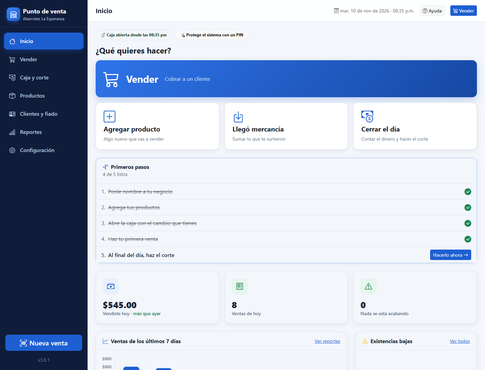
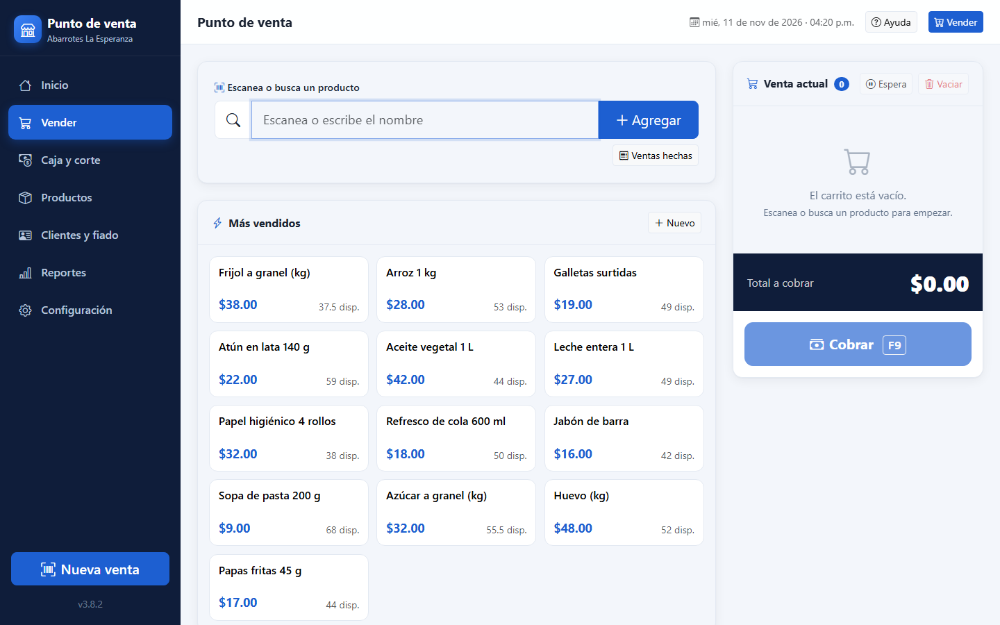
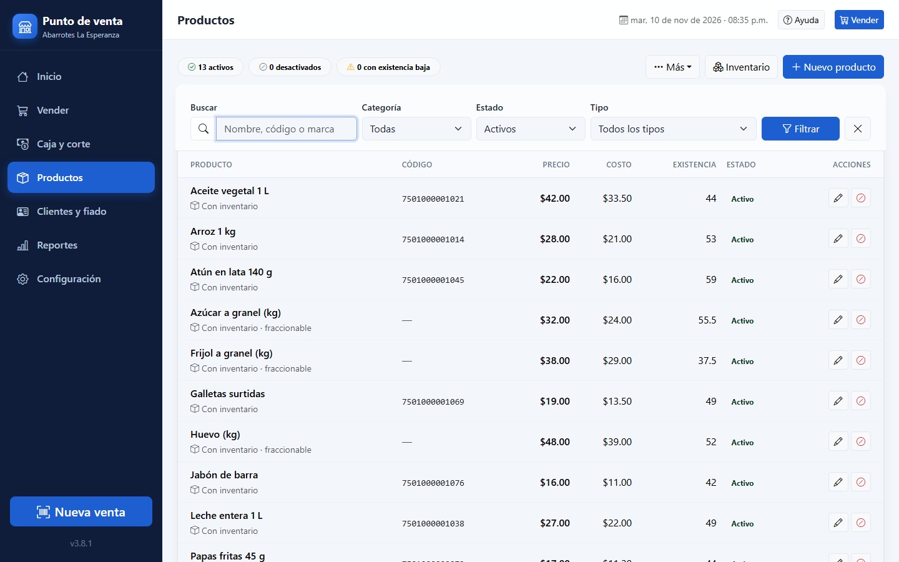
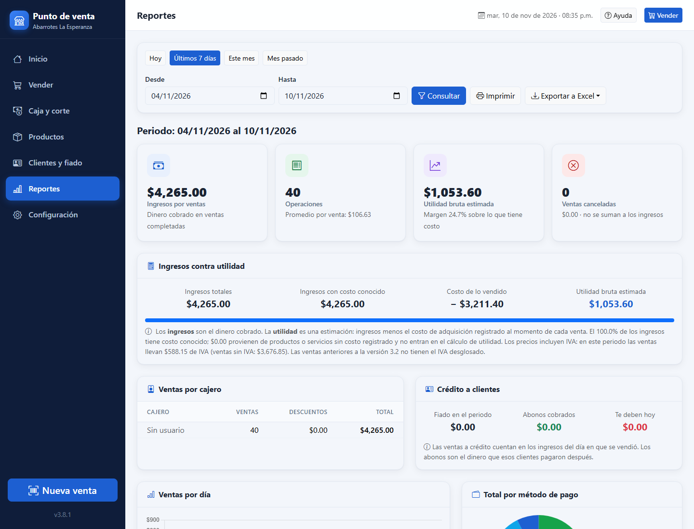

# Punto de venta

Punto de venta de escritorio para tiendas pequeñas de México: abarrotes, licorerías, papelerías o cualquier otro giro. Está pensado para que lo use alguien que no sabe de computadoras: botones grandes, pocos pasos y todo en español.

> **English summary:** A desktop point-of-sale for small Mexican shops (grocery, liquor, stationery or any other store). PHP + SQLite, packaged as a Windows app with PHP Desktop (embedded Chromium) and an Inno Setup installer. Includes barcode sales, cash register shifts, inventory, store credit, Mexican VAT (IVA) per product, ESC/POS ticket printing, reports, daily backups and an end-to-end test suite.



## Qué hace

- **Vender rápido:** con lector de códigos de barras, buscando por nombre o tocando los botones de los más vendidos. Maneja productos a granel (kilos, metros) y ventas en espera.
- **Cobrar:** efectivo con cálculo de cambio, tarjeta, transferencia, crédito ("fiado") o un pago dividido entre varias formas. Acepta descuentos en monto o porcentaje.
- **Caja:** apertura con fondo, entradas y salidas de efectivo, y corte del día que dice si sobra o falta dinero.
- **Inventario:** entradas de mercancía, conteo físico, avisos de existencia baja e historial de cada producto.
- **IVA mexicano:** tasa por producto (16%, 8%, 0% o exento), incluida en el precio y desglosada en el ticket y los reportes.
- **Clientes y fiado:** límite de crédito, saldo, abonos y estado de cuenta.
- **Usuarios con PIN:** dueño y cajeros con permisos, más una bitácora de quién hizo qué.
- **Reportes:** ventas, utilidad, métodos de pago, cajeros y productos más vendidos; todo exportable a Excel.
- **Tickets:** impresora térmica ESC/POS (58 u 80 mm) y cajón de dinero.
- **Respaldos:** copia automática diaria y respaldo manual a USB.
- **Funciones avanzadas (opcionales):** compras a proveedores, precios de mayoreo, paquetes y kits, listas escolares y etiquetas con código de barras.

### Para cualquier giro

En el primer uso se elige el tipo de negocio. Eso cambia los productos de ejemplo, las categorías sugeridas y algunos textos; lo demás funciona igual para todos.

| Primer uso | Vender |
|---|---|
|  |  |

| Productos | Reportes |
|---|---|
|  |  |

*Las capturas usan datos de ejemplo.*

## Cómo está hecho

- **PHP 8.2+** sin frameworks, con **SQLite**: todos los datos viven en un solo archivo y no hace falta instalar un servidor de base de datos.
- **Bootstrap 5.3**, Bootstrap Icons, Chart.js y SweetAlert2, incluidos en `assets/vendor` para que funcione sin internet.
- **App de escritorio:** [PHP Desktop](https://github.com/cztomczak/phpdesktop) (Chromium integrado) y un instalador de **Inno Setup** que no pide permisos de administrador.
- **Datos fuera del programa:** se guardan en `%LOCALAPPDATA%\TiendaWeb`, así que actualizar o reinstalar no borra nada. El esquema de la base se migra solo al abrir una versión nueva.
- **Seguridad:** tokens CSRF en todos los formularios, PIN con `password_hash`, consultas preparadas y permisos por usuario.

## Correrlo en desarrollo

Requiere PHP 8.2 o más reciente con `pdo_sqlite` y `mbstring`.

Desde la carpeta del proyecto:

```bash
php -S 127.0.0.1:8000 -t .
```

Abre `http://127.0.0.1:8000/`. La primera vez aparece el asistente de primer uso. Para no tocar datos reales, define la variable `TIENDAWEB_DATOS` con una carpeta de pruebas.

## Pruebas

```bash
php tests/correr.php
```

Son pruebas unitarias y de punta a punta: cada una levanta su propio servidor con una base temporal y usa el sistema como lo haría un cajero (asistente, ventas, IVA, caja, devoluciones, crédito, giros y más). Nunca tocan los datos del negocio.

## Armar el instalador

1. Descarga PHP Desktop (Chrome, PHP 8.3) y descomprímelo.
2. Arma la app: `powershell -ExecutionPolicy Bypass -File empaquetar\armar_app.ps1 -PhpDesktop "C:\ruta\a\phpdesktop"`
3. Compila el instalador con Inno Setup 6.3+ o 7: `ISCC.exe empaquetar\instalador.iss`

El instalador listo para usar se publica en [Releases](../../releases).

## Manual

El manual completo de uso, instalación y mantenimiento está en [README.txt](README.txt).

## Licencia

Copyright (C) 2026 emiGardela

Este programa es software libre bajo la [GNU General Public License v3.0](LICENSE): puedes usarlo, estudiarlo, modificarlo y distribuirlo, pero cualquier versión modificada que distribuyas también debe publicarse con su código bajo la misma licencia.

Las librerías incluidas en `assets/vendor` (Bootstrap, Bootstrap Icons, Chart.js y SweetAlert2) conservan su propia licencia MIT; cada una trae su archivo `LICENSE.txt`.
